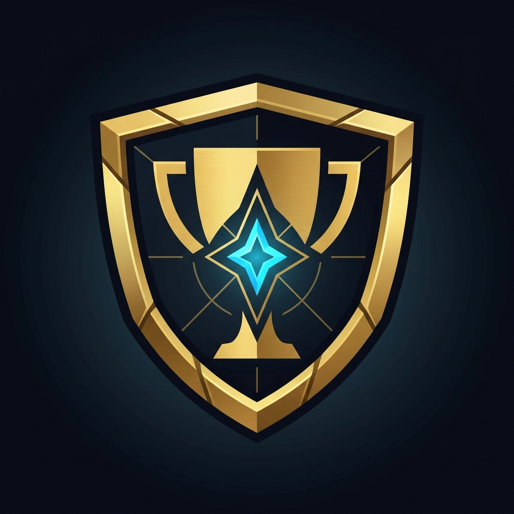

<p align="center">
  
</p>

# LoL Esports Manager — Football Manager Edition

**League of Legends** espor sahnesi için **Football Manager** derinliğinde, tarayıcıda çalışan, harici bağımlılık gerektirmeyen kulüp yönetim ve maç simülasyonu oyunu.

## v2.0 Özellikleri
- **7 Bölge, 56 Takım & 280+ Oyuncu:** **LCK, LPL, LEC, LCS, TCL (Türkiye), CBLOL (Brezilya)** ve **LCO (Okyanusya)**.
- **Fearless Draft (BO3 / BO5) & Rakip Scouting:** Önceki maçlarda seçilen şampiyonlar serinin devamında kilitlenir; maç öncesi rakip scout raporu, counter eşleşme analizi ve şampiyon ustalığı (Mastery) bulunur.
- **Canlı 2D Mini Harita & Rol Bazlı Mikro Taktikler:** 10 oyuncunun hareketli 2D mini haritası, canlı Altın Farkı grafiği, takım + rol bazlı mikro taktik emirleri (*Top Carry/Weakside, Sup Roam/Peel, ADC Agresif/Güvenli*) ve maç sonu derin analitik (`GD@15`, `DMG%`, `Görüş`).
- **İnsan Faktörü, Kişilikler & Drama Olayları:** 6 farklı oyuncu kişiliği (*Büyük Maç, Lider, Çalışkan, Yayıncı, Tilt, Egoist*), dil bariyeri/import uyumu, haftalık interaktif kriz & basın toplantısı kararları.
- **SoloQ Challenger Wonderkid Avı & AI Transfer Teklifleri:** Gizli potansiyelli 16–18 yaş Challenger gençlerini scoutla, ucuza imzala ve AI kulüplerinden gelen transfer tekliflerini yönet.
- **16 Takımlı Worlds İsviçre Aşaması (Swiss Stage) & Derbiler:** 7 bölge şampiyonlu MSI, 16 takımlı gerçek Worlds İsviçre Aşaması (3 galibiyet Çeyrek Final / 3 mağlubiyet elenir), derbiler ve sezon ödülleri (*MVP, All-Pro, Yılın Çaylağı*).
- **🔥 Worlds Mayhem (Arcade Modu):** LoLdle Worlds Mayhem tarzı, 3 reroll hakkıyla 5 efsane sezon kartı (*2015 Faker, 2018 TheShy, 2023 Zeus, 2020 Canyon...*) seçip anında Worlds simüle et!

## Çalıştırma
```bash
python3 -m http.server 8765
```
Tarayıcıda `http://localhost:8765` adresini açın.
